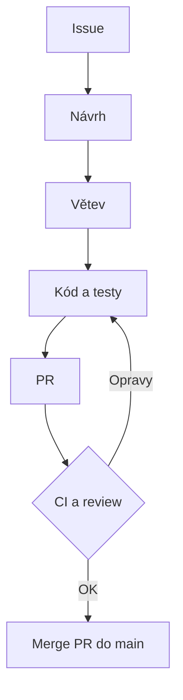

# IFJ26

Týmový projekt IFJ a IAL na FIT VUT, akademický rok 2026/2027.
Překladač v C převádí zdrojový program IFJ26 na IFJcode26.

- **Autoři:** [AUTHORS](../AUTHORS).
- **Varianta:** `vv-BVS`.
- **Rozšíření:** doplnit podle dohody týmu.
- **Jazyk:** C11; vývojové prostředí používá GCC 16.
- **Pravidla a návody:** [CONTRIBUTING](CONTRIBUTING.md).
- **Zadání a aktuality:** [stránka projektu](https://www.fit.vut.cz/study/course/IFJ/public/project/) a Moodle IFJ.

## Začátek práce

1. Přečti [pravidla týmu](CONTRIBUTING.md#pravidla-týmu).
2. Nastav si [jméno a e-mail pro Git](CONTRIBUTING.md#nastavení-gitu).
3. Připrav si [vývojové prostředí](CONTRIBUTING.md#prostředí).
4. Vyber issue a založ vlastní větev.
5. Domluv rozhraní s lidmi, jejichž části na tvou práci navazují.

## Workflow



## Použití po implementaci

Příkazy spouštěj v kořeni repozitáře, například uvnitř vývojového Dockeru.

```sh
make
./ifj26 < program.ifj > program.code && ic26int program.code < input.txt > output.txt
```

- `make` sestaví program `ifj26`.
- `program.ifj` je zdrojový program IFJ26.
- `program.code` je výsledek překladu do IFJcode26.
- `input.txt` obsahuje vstup pro přeložený program.
- `output.txt` zachytí jeho výstup.
- `&&` spustí interpret jen při úspěšném překladu.
- Bez vstupních dat použij místo `< input.txt` přesměrování `< /dev/null`.
- `ic26int` je školní interpret. Musí být v `PATH`, nebo použij jeho úplnou cestu.
- Chybová hlášení jdou na `stderr`; úspěšný překlad vrací kód `0`.
- Zdrojové soubory a testy zatím nejsou doplněné; příkazy vyžadují vlastní implementaci.

## Kde co je

| Cesta | Obsah |
| --- | --- |
| `src/` | Zdrojové a hlavičkové soubory C. |
| `tests/unit/` | Testy jednotlivých modulů. |
| `tests/system/` | Vstupní programy a očekávané výsledky. |
| `docs/` | Vlastní zdroje závěrečné dokumentace a diagramy. |
| `tools/` | Nástroje pro vývoj, testy a balení. |
| `tools/local/` | Lokální školní nástroje; nepatří do Gitu. |
| `.github/` | Tento přehled, pravidla, formuláře a automatické kontroly. |
| `Makefile` | Sestavení programu a vývojové příkazy. |
| `Dockerfile`, `compose.yaml` | Společné vývojové prostředí. |
| `.clang-format`, `.editorconfig`, `.gitattributes` | Formátování a konce řádků. |
| `AUTHORS`, `rozdeleni` | Autoři a dohodnuté podíly. |
| `dokumentace.pdf` | Vlastní závěrečná dokumentace po dokončení. |
| `VERSION`, `CHANGELOG.md` | Verze projektu a historie změn. |
| `Doxyfile` | Nastavení programové dokumentace. |
| `build/`, `ifj26`, `dist/` | Generované soubory; necommitovat. |
